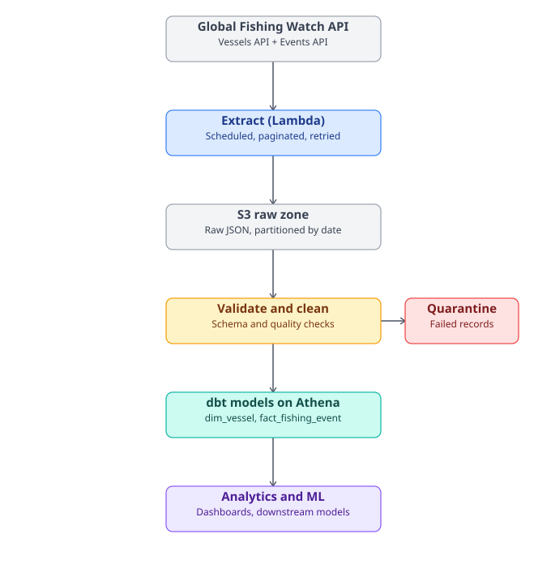

# Take Home Assignment — GFW Data Pipeline

A data pipeline that ingests two Global Fishing Watch (GFW) datasets — vessel
identity and fishing events — validates and models them, and is designed for
cloud deployment on AWS. Built as a Data Engineer take-home assignment.

## What this is

- **Ingests** vessel identity and fishing-event data from the GFW v3 API
- **Validates** every record (schema, dedup, range checks, referential
  integrity) and routes failures to a quarantine zone instead of dropping
  or silently keeping them
- **Models** the clean data into a `dim_vessel` / `fact_fishing_event` star
  schema with dbt, running against the deployed Athena/Glue Data Catalog
- **Runs three ways**: fully local with no dependencies, local with a
  Postgres/Adminer stack for visual inspection, or deployed to AWS

**Status: deployed and confirmed working end to end on a real AWS
account** — extraction, validation, cataloguing, and the full dbt run
(`dbt run` + `dbt test`) have all completed successfully against the
live pipeline. See `dbt_flow.md` for the exact sequence used to get dbt
running for the first time, including the mistakes hit along the way.

## Architecture



Global Fishing Watch API → **Extract (Lambda)**, scheduled and paginated →
**S3 raw zone** (untouched JSON, partitioned by date) → **Validate**
(schema + quality checks, with a **Quarantine** branch for anything that
fails) → **dbt models on Athena** (`dim_vessel`, `fact_fishing_event`) →
**Analytics and ML** consumers.

## Repository structure

```
take-home-assignment/
├── README.md
├── dbt_flow.md                  # the exact commands used to get dbt running, in order
├── architecture.svg
├── deploy.sh                    # convenience wrapper around sam build/deploy
├── docker-compose.yml           # local demo: Postgres + Adminer
├── requirements.txt             # redirects to src/requirements.txt
├── requirements-dev.txt         # + pytest, python-dotenv
├── requirements-local-demo.txt  # + psycopg2, for the Postgres demo path only
├── requirements-dbt.txt         # + dbt-athena-community, for the dbt path only
├── .env.example
├── conftest.py                  # puts src/ on the path for pytest
├── db/
│   └── schema.sql                # local Postgres DDL, mirrors the dbt marts
├── src/
│   ├── requirements.txt           # the real dependency list Lambda ships with
│   ├── config.py                  # auth, dataset ids, demo scope
│   ├── gfw_client.py              # auth, retry/backoff, pagination
│   ├── extract_vessels.py
│   ├── extract_events.py
│   ├── schemas.py                 # Pydantic models matching GFW's real response shapes
│   ├── validate.py                # schema + quality checks, quarantine routing
│   ├── storage.py                 # S3-or-local read/write, by zone
│   ├── run_local_pipeline.py      # extract -> extract -> validate, one command
│   └── load_local_postgres.py     # clean zone -> local Postgres, for Option B below
├── dbt/
│   ├── dbt_project.yml
│   ├── packages.yml
│   ├── profiles.yml.example       # the exact working profile shape -- see dbt_flow.md
│   └── models/
│       ├── staging/               # sources.yml, stg_vessels.sql, stg_fishing_events.sql
│       └── marts/                 # dim_vessel.sql, fact_fishing_event.sql, schema.yml
├── tests/
│   ├── test_gfw_client.py
│   ├── test_validate.py
│   └── test_load_local_postgres.py
└── infra/
    └── template.yaml               # SAM template: Lambda, S3, Step Functions, Glue, SNS
```

## Prerequisites

- Python 3.11+
- A GFW API token — [get one here](https://globalfishingwatch.org/our-apis/tokens)
- **Docker + Docker Compose**, only needed for Option B below
- **An AWS account, the AWS CLI, and the AWS SAM CLI**, only needed for
  Option C below — none of these are required for Options A or B

Set the token once, either way:

```bash
cp .env.example .env
# edit .env and paste the real token in place of your_token_here
export $(grep -v '^#' .env | xargs)   # or use python-dotenv, or just `export GFW_API_TOKEN=...` directly
```

---

## Option A — Run locally, no AWS, no Docker

The fastest way to see it work.

```bash
pip install -r requirements.txt
cd src
python run_local_pipeline.py
```

This runs `extract_vessels → extract_events → validate` as one chain, the
same way Step Functions does in production, and prints a summary of what
was written. Output lands under `src/data/`:

```
data/
├── raw/gfw/dataset={vessels,events}/date=.../run-....jsonl
├── clean/gfw/dataset={vessels,events}/date=.../run-....jsonl
└── quarantine/gfw/dataset={vessels,events}/date=.../run-....jsonl
```

Inspect it with `cat`/`less`, or `jq`:

```bash
cat data/clean/gfw/dataset=vessels/date=*/run-*.jsonl | jq .
```

---

## Option B — Run locally and see it in Postgres (Docker Compose)

For browsing tables instead of reading JSON lines. This is a **local demo
convenience only** — it re-implements the dbt marts' logic in plain
Python/SQL to get the same `dim_vessel` / `fact_fishing_event` shape running
locally, without needing Athena. It is not the production target (that's
Option C).

```bash
pip install -r requirements-local-demo.txt
docker compose up -d          # starts Postgres (auto-creates the tables from db/schema.sql) + Adminer

cd src
python run_local_pipeline.py     # extract + validate, as in Option A
python load_local_postgres.py    # load the clean zone into Postgres
```

Then open **http://localhost:8080** (Adminer) and log in with:

| Field | Value |
|---|---|
| System | PostgreSQL |
| Server | `db` |
| Username | `postgres` |
| Password | `postgres` |
| Database | `take_home_assignment` |

`dim_vessel` and `fact_fishing_event` show up populated and queryable —
`fact_fishing_event.vessel_id` even carries a real foreign key to
`dim_vessel`, which Postgres enforces (Athena doesn't enforce FKs at all;
that's what dbt's `relationships` test is for instead).

Re-running `load_local_postgres.py` is safe — it upserts on the primary key,
so running it again after a fresh `run_local_pipeline.py` just updates
existing rows rather than duplicating them.

Tear down with `docker compose down -v` (the `-v` also drops the persisted
volume, for a clean slate next time).

---

## Option C — Deploy to AWS

With an AWS account, the AWS CLI configured (`aws configure`),
[Docker](https://www.docker.com/products/docker-desktop/) running, and the
[AWS SAM CLI](https://docs.aws.amazon.com/serverless-application-model/latest/developerguide/install-sam-cli.html)
installed, this deploys for real. The account needs permission to create
Lambda functions, S3 buckets, IAM roles, Step Functions state machines,
Glue databases/tables, and an SNS topic — an admin-level IAM user or the
root user has this by default on a personal account; a locked-down IAM
user in a work account might not.

Docker is there for one specific reason: `sam build --use-container` builds
dependencies inside a container matching Lambda's actual Python
environment, rather than using whatever Python happens to be installed
locally. Skipping `--use-container` risks a mismatch between the local
Python version and the Lambda runtime, which can produce a build that
looks successful but fails at import time in Lambda — see Troubleshooting
below.

**Why `deploy.sh`, when SAM already does this?** `sam build --use-container
&& sam deploy --guided` from `infra/` does the same job on its own, and is
the more standard way to do it. `deploy.sh` exists mainly to also automate
the one-time Secrets Manager setup, so the first deploy is one command
instead of two separate steps.

### 1. Deploy

```bash
./deploy.sh
```

This prompts for a GFW token (hidden input, never logged), creates a
Secrets Manager secret for it if one doesn't already exist, then runs
`sam build --use-container` and `sam deploy --guided` under the hood.
Answering the guided prompts (stack name, region, confirm changeset) makes
SAM save the answers to `infra/samconfig.toml`, so future deploys are
non-interactive.

Or do it manually:

```bash
aws secretsmanager create-secret \
  --name take-home-assignment/gfw-api-token \
  --secret-string "THE_TOKEN_GOES_HERE_NO_EXTRA_QUOTES"

cd infra
sam build --use-container
sam deploy --guided --capabilities CAPABILITY_IAM \
  --parameter-overrides GfwApiTokenSecretArn=$(aws secretsmanager describe-secret \
    --secret-id take-home-assignment/gfw-api-token --query ARN --output text)
```

A note on that `--secret-string` value, since it's an easy place to get
wrong: the outer `"..."` are the shell's own quoting, telling it "this is
one argument" — they are never stored as part of the secret. Only the
literal token characters between them become the secret value. No extra
quotes, no braces, nothing else. To confirm exactly what's stored (this is
also the fastest way to debug an "invalid token" error in Lambda when the
same token works fine locally):

```bash
aws secretsmanager get-secret-value \
  --secret-id take-home-assignment/gfw-api-token \
  --query SecretString --output text
```

This should print the raw token and nothing else. If it's wrapped in `{`
`}` or has visible quote marks around it, that's the bug — usually caused
by creating the secret through the AWS Console's default "Key/value pairs"
tab instead of "Plaintext". Fix it with (not a full delete and recreate):

```bash
aws secretsmanager put-secret-value \
  --secret-id take-home-assignment/gfw-api-token \
  --secret-string "THE_CORRECT_TOKEN"
```

then redeploy (`sam build --use-container && sam deploy`, no `--guided`
needed once `samconfig.toml` exists) so CloudFormation re-resolves the
`{{resolve:secretsmanager:...}}` reference in `template.yaml` and pushes
the corrected value into the Lambda's environment.

### 2. Run it now, instead of waiting for the daily schedule

```bash
STATE_MACHINE_ARN=$(aws cloudformation describe-stacks \
  --stack-name take-home-assignment \
  --query "Stacks[0].Outputs[?OutputKey=='StateMachineArn'].OutputValue" --output text)

aws stepfunctions start-execution --state-machine-arn "$STATE_MACHINE_ARN"
```

### 3. Check the output landed in S3

```bash
BUCKET=$(aws cloudformation describe-stacks --stack-name take-home-assignment \
  --query "Stacks[0].Outputs[?OutputKey=='DataBucketName'].OutputValue" --output text)

aws s3 ls "s3://$BUCKET/clean/gfw/" --recursive
```

### 4. The catalog — no crawler needed

`dataset_vessels` and `dataset_events` are defined directly in
`template.yaml` as static Glue tables, with partition projection
configured on the `date` partition. That means there's no crawler to run
and nothing to wait for: the moment the pipeline writes a new
`date=YYYY-MM-DD` partition into the clean zone, Athena can already see
it, because it computes valid partitions from the projection pattern at
query time rather than needing them registered in advance.

I went with this instead of a crawler once the schema was fully known —
a crawler's value is *discovering* an unknown shape, and the clean
zone's shape isn't unknown, it's exactly what `schemas.py` already
validates every record against before it's written. Declaring the table
once removes a moving part (and its cost) entirely, rather than paying
for a crawler to re-derive something already on file. Column types were
taken directly from real sample records pulled from the raw bucket, not
guessed.

The tables are queryable in the Athena console immediately after the
first successful pipeline run, under the `gfw_clean` database — no
extra step required.

### 5. Run dbt against it

```bash
pip install -r requirements-dbt.txt
```

Copy `dbt/profiles.yml.example` into `~/.dbt/profiles.yml` and fill in a
real S3 bucket for `s3_staging_dir` (any bucket in the account works, used
purely to hold Athena's own query result files). The two fields worth
understanding rather than just copying:

- `database` — this means the Athena **Data Catalog**, not the Glue
  database. Almost always the fixed value `AwsDataCatalog`; every AWS
  account has exactly one, addressed by this name regardless of account id.
- `schema` — the actual Glue database name (`gfw_clean`). Worth confirming
  directly in the Glue console rather than assuming, especially if more
  than one Glue database ever exists in the account (e.g. from earlier
  manual testing) — pointing dbt at the wrong one fails with a
  `DataCatalog was not found` or `Table does not exist` error that looks
  like a bigger problem than it is.

```bash
cd dbt
dbt deps      # installs dbt_utils, needed for the range tests in schema.yml
dbt debug     # confirms the profile can reach Athena at all
dbt run       # materializes stg_vessels, stg_fishing_events, dim_vessel, fact_fishing_event
dbt test      # runs the unique/not_null/relationships/accepted_values/range tests
```

`dim_vessel` and `fact_fishing_event` then show up as new tables in the
same Glue database, queryable directly in Athena. See `dbt_flow.md` for
the full first-time walkthrough, including the specific errors hit and
how each was resolved — useful if setting this up again from scratch.

### Redeploying after a fix — update in place, don't delete and recreate

CloudFormation stacks are meant to be updated, not torn down for every
change. Deleting the whole stack (`sam delete`) and rebuilding from
scratch every time something breaks is slow and burns through AWS credit
faster than necessary — mainly from repeated deploy/teardown cycles and general
resource churn, all of which is avoidable. What each kind of fix actually
needs:

- **A code change** (e.g. a bug in `extract_vessels.py`): `sam build
  --use-container && sam deploy` — no `--guided`, since `samconfig.toml`
  already has the saved answers. This updates only the Lambda function
  code, in place.
- **A wrong secret value**: `aws secretsmanager put-secret-value` (never
  delete and recreate the secret — that changes its ARN, which then has to
  be passed as a fresh `--parameter-overrides` value), followed by `sam
  deploy` to make CloudFormation re-resolve the reference into Lambda's
  environment.
- **A `template.yaml` structural change**: same as a code change — `sam
  build --use-container && sam deploy`.
- **Full delete and redeploy** should be rare — really only for a stack
  that's gotten stuck in a broken state (e.g. `ROLLBACK_COMPLETE`) that
  won't accept further updates.

### Cost and cleanup

This is a genuinely cheap stack to run occasionally — S3 storage is
pennies, and Lambda/Step Functions invocations for a daily two-source batch
sit comfortably inside AWS's free tier. It isn't literally free, though:
Secrets Manager bills roughly $0.40/month per secret regardless of use. Once testing is
complete:

```bash
sam delete --stack-name take-home-assignment
aws secretsmanager delete-secret \
  --secret-id take-home-assignment/gfw-api-token \
  --force-delete-without-recovery   # skips the default 30-day recovery window
```

### Troubleshooting

**`Runtime.ImportModuleError: No module named 'requests'` (or boto3,
pydantic)** — SAM's Python builder only looks for `requirements.txt`
directly inside `CodeUri` (`src/`), not at the project root. The real
dependency list lives in `src/requirements.txt` for exactly this reason;
the root `requirements.txt` is just a redirect for local
`pip install -r requirements.txt` convenience. `CodeUri` in
`template.yaml` needs to stay pointed at `../src/` — widening it to the
whole project root would bundle `dbt/`, `tests/`, and everything else into
every Lambda's zip instead of fixing the real problem.

To confirm a build actually picked up the dependencies before deploying,
check the build output directory after `sam build`:

```bash
ls .aws-sam/build/ExtractVesselsFunction/
```

`requests/`, `boto3/`, `pydantic/` etc. should be sitting alongside
`extract_vessels.py` and the rest of `src/`. If they're not there, the
dependency install step didn't run.

**Manually zipping `requirements.txt` and the code together, to be sure
dependencies never go missing** isn't necessary — that's what `sam build`
already does automatically and reproducibly, once `requirements.txt` is
where it looks for it (see above). Zipping by hand would mean giving up
SAM's declarative build process for something that would have to be redone
by hand on every code change.

**Local Python version doesn't match the Lambda `Runtime`, or a build
"succeeds" but the function fails at import time in Lambda anyway** — by
default, `sam build` uses whatever Python is on the local PATH to resolve
and install dependencies, which can produce incompatible binaries
(particularly for packages with compiled components, like pydantic's Rust
core) if that doesn't match the Lambda runtime declared in
`template.yaml`. Always build with `sam build --use-container` (already
what `deploy.sh` does) — it builds inside a container matching Lambda's
real environment, so the local Python version stops mattering. This needs
Docker Desktop running; plain `sam build` ignores Docker entirely, so the
flag has to be passed explicitly every time.

**An "invalid token" error from Lambda, when the same token works fine
locally** — almost always a Secrets Manager formatting issue, not a code
issue. See the note under Step 1 above: verify with `get-secret-value`
that the stored secret is the bare token and nothing else, fix it with
`put-secret-value` if not, then redeploy so the fix actually reaches
Lambda's environment.

**`KeyError: 'GFW_API_TOKEN'` in `ValidateFunction` specifically** (while
`ExtractVesselsFunction` and `ExtractEventsFunction` succeed) — `validate.py`
imports `storage.py`, which imports `config.py`, and `config.py` reads
`GFW_API_TOKEN` from the environment unconditionally at import time, even
though `validate.py` never actually calls the GFW API. `GFW_API_TOKEN`
lives in `Globals.Function.Environment.Variables` in `template.yaml` for
exactly this reason — every function inherits it, so the import succeeds
everywhere, regardless of which functions genuinely need it.

**A `dotenv`-related `ImportModuleError`** — adding
`from dotenv import load_dotenv` for local convenience needs to be guarded
the way `config.py` already does it (try/except ImportError) rather than a
bare import, and `python-dotenv` needs to stay out of
`src/requirements.txt` — Lambda doesn't need it (the token arrives as a
real environment variable already) and a bare import there breaks the
Lambda build the same way the missing `requests` did.

**dbt: `DataCatalog ... was not found` on `dbt run`, even though `dbt
debug` passed** — `database` in `profiles.yml` was set to a Glue database
name instead of the Athena Data Catalog. `dbt debug`'s connection check is
lightweight and doesn't catch this; `dbt run` does, the first time it
needs to look up an existing table. Fix: `database: AwsDataCatalog`,
leave the real Glue database name in `schema`. Full detail in `dbt_flow.md`.

**dbt: `Table ... does not exist`, after fixing the above** — the `schema`
value pointed at the wrong Glue database (e.g. one created by hand while
testing, rather than the one the CloudFormation stack actually populates).
Confirm the real database and table names directly in the Glue console
and update both `profiles.yml`'s `schema` and `sources.yml`'s `schema`/
`tables` to match exactly.

**dbt: `Column 'entry.selfreportedinfo' cannot be resolved`** — a missing
table alias in `stg_vessels.sql`: the `FROM` clause needs
`{{ source(...) }} as entry` for the `entry.selfreportedinfo` reference on
the next line to resolve. Already fixed in this version of the file.

**dbt: `MissingArgumentsPropertyInGenericTestDeprecation` warning** — dbt
1.12 moved generic test arguments (`to`, `field`, `values`, `min_value`,
`max_value`) to be nested under an `arguments:` key rather than sitting
directly under the test name. Already using the current syntax in
`schema.yml` — if this warning reappears after editing that file, check
any new test blocks follow the same nested shape.

**dbt: `unique_fact_fishing_event_event_id` fails, with the result count
matching the total number of real events exactly** — not a broken test;
it caught something real. Events extraction originally used a fixed
historical window (`EVENTS_START_DATE`/`EVENTS_END_DATE` in `config.py`)
rather than "since last run," so every pipeline execution re-extracted
the same events, and S3 partitions by ingestion date, not by run — two
executions on the same calendar day (easy to do with manual testing, or
the daily schedule running more than once) landed two copies of the same
events in that day's partition, which Athena reads as one unioned table.
Two layers fixed this: `extract_events.py` now extracts an incremental
window instead of a fixed one (see "Events extraction is incremental"
below), which prevents new duplicates from being created; and
`fact_fishing_event.sql` dedupes with the same `row_number()` pattern
`dim_vessel.sql` already uses for vessel snapshots, as a safety net
regardless. Both were verified against real duplicated data before
calling it fixed, not just assumed to work.

---

## Running the tests

```bash
pip install -r requirements-dev.txt
pytest tests/ -v
```

24 tests, all against mocked HTTP calls or inline fixtures shaped like
GFW's real responses — no network access or AWS credentials needed to run
them.

## Design choices, and why

- **Lambda + EventBridge + Step Functions, not MWAA**, for orchestration —
  MWAA carries an hourly cost even sitting idle; for a scheduled daily pull
  of two sources, pay-per-invocation Lambda fits the brief's "startup
  budget" constraint better. This would flip to MWAA once there are enough
  interdependent pipelines to justify an always-on orchestrator.
- **Athena + S3 + Glue Catalog, not a provisioned Redshift cluster** — no
  idle warehouse cost, scales to zero between runs. Redshift/Snowflake
  earns its cost once there's steady concurrent query load.
- **Static, partition-projected Glue tables, not a crawler** — a crawler's
  value is discovering an unknown schema; the clean zone's schema isn't
  unknown, it's exactly what `schemas.py` already validates every record
  against. Declaring the tables once, with partition projection so Athena
  computes valid partitions at query time, removes a moving part (and a
  recurring per-run cost) that wasn't earning its keep here. Column types
  were taken from real sample records, not guessed.
- **dbt for transformation** — version-controlled, tested SQL instead of
  one-off scripts, and it's the tool named in the actual job description
  this assessment is for.
- **Vessels + Events, not the 4Wings map/raster endpoints** — these two
  form a natural dimension/fact pair, and Events specifically surfaces
  encounters, loitering and port visits: the classic IUU-fishing risk
  signals, which line up with the risk/compliance side of what the target platform actually builds.

## Assumptions and scope

- **Demo scope is deliberately small** — `SEED_VESSEL_QUERIES` in
  `config.py` is a short fixed list (currently just the vessel from GFW's
  own quick-start example, IMO `7831410`) rather than a full
  vessel-discovery service, to keep runtime and data volume demoable
  within a few hours. Swap in other IMO/MMSI/vessel names to try more.
- **Vessel identity uses the `search` endpoint**, not "get vessels by ids" —
  GFW's docs fully confirm `search`'s parameters; the other endpoint's
  weren't fully confirmed, and shipping code against a guessed contract
  for something that has to actually run didn't seem worth the risk.
- **`search_vessels` doesn't paginate with `offset`** — its schema doesn't
  define that property at all, and passing one returns a live 422
  ("property offset should not exist"), confirmed by running this against
  the real API rather than relying on the docs alone. `/v3/events`
  genuinely does accept `offset`, so this is endpoint-specific, not a
  blanket rule — see the docstring on `search_vessels` in `gfw_client.py`,
  and `test_search_vessels_never_sends_offset` in
  `tests/test_gfw_client.py`, which locks this in as a regression test.
- **Events extraction is incremental, not a fixed demo window** —
  `extract_events.py`'s `compute_extraction_window()` picks up from a
  persisted watermark (the end date of the last successful run) rather
  than re-processing a static date range every time. The window's end
  date always stays `EVENTS_LAG_DAYS` (5, in `config.py`) behind "now,"
  to respect GFW's own publication delay — their docs confirm a 5-day
  lag for SAR vessel detections specifically; the AIS-based datasets
  this pipeline actually reads are documented closer to 3-4 days, so 5
  is a deliberately conservative buffer either way. The very first run
  ever (no watermark yet) looks back `EVENTS_INITIAL_LOOKBACK_DAYS` (30)
  days. Two runs close together compute the same window and the second
  one extracts nothing rather than re-fetching — see the Troubleshooting
  section's note on the duplicate-events issue this exists to prevent.
- **The events schema captures authorization/compliance signals, not just
  activity data** — `vessel.publicAuthorizations` and
  `fishing.vesselPublicAuthorizationStatus` were added to `schemas.py`
  after checking a real 20-record sample from the raw zone, where both
  were present and non-empty in every record. That status field is
  GFW's own derived read on whether a vessel appears to hold proper
  fishing authorization for the RFMO it operated under during that
  event — a risk signal, not incidental data, and one worth keeping
  given the risk/compliance side of what the target platform
  actually does. One quirk worth knowing if extending this further:
  `hasPubliclyListedAuthorization` arrives as the string `"false"`, not
  a JSON boolean — modeled as a string on purpose rather than coerced,
  so that quirk stays visible instead of silently "fixed" into something
  the raw API doesn't actually send. `boundingBox` was added too, kept
  as a plain 4-value array rather than decomposed into named min/max
  lon/lat fields, since GFW's docs don't explicitly confirm that
  ordering and asserting it would be a guess dressed up as a fact.
- **Glue tables are declared statically rather than crawled** — this
  trades away automatic schema discovery: if GFW ever adds a new field
  worth capturing, or a third dataset gets added, the table definitions
  in `template.yaml` need updating by hand, rather than being picked up
  automatically on a crawler's next run. A reasonable trade for two
  datasets with an already well-understood, Pydantic-validated shape.
- **dbt has been run successfully against the live deployment** — models
  build clean and all data tests pass against real cataloged data. See
  `dbt_flow.md` for the exact setup sequence.

## How this would handle larger volumes

- **Ingestion**: move from single Lambda invocations to a Step Functions
  Map state or Glue Python shell jobs once the number of vessels/regions
  exceeds what fits in a 15-minute Lambda timeout
- **Storage**: partition raw and curated data by date (and region/flag) to
  keep query costs down and enable parallel processing
- **Table format**: move from plain JSON/Parquet to Apache Iceberg once
  upserts, schema evolution, or time travel are needed — i.e. once
  full-table rewrites get too expensive
- **Transformation**: move dbt models from full-refresh to incremental as
  historical volume grows
- **Orchestration**: move from EventBridge + Lambda to Step Functions Map
  states or MWAA once there are enough interdependent pipelines to justify
  an always-on orchestrator
- **Query layer**: move from Athena to a provisioned Redshift Serverless or
  cluster once concurrent query load or join complexity outgrows
  pay-per-query economics
